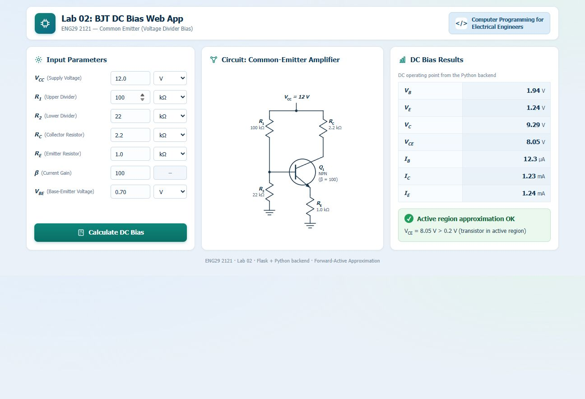

# BJT DC Bias Calculator — ENG29 2121 Lab 02

Flask web application that solves the DC operating point of an NPN
common-emitter amplifier with **voltage-divider bias**.

The page only collects values and displays results; every electrical equation
runs in Python on the server (`dc_bias.py`) and is covered by automated tests.



## Requirements

- Python 3.10 or newer (`python --version`)
- Internet access the first time to download Flask

## Install and run

Windows PowerShell:

```powershell
python -m venv .venv
.\.venv\Scripts\Activate.ps1
python -m pip install -r requirements.txt
python -m flask --app app run --debug
```

macOS / Linux:

```bash
python3 -m venv .venv
source .venv/bin/activate
python -m pip install -r requirements.txt
python -m flask --app app run --debug
```

Open <http://127.0.0.1:5000/> in a browser.

> The app must be served by Flask. Opening `templates/index.html` directly with
> `file://` shows the form but nothing is ever calculated, because there is no
> Python backend behind it.

## Run the tests

```powershell
python -m unittest discover -s tests -v
```

Expected: **22 tests, OK** (17 engineering tests + 5 HTTP tests).

## Project structure

```
transistor-simulator/
├── app.py               # Flask app and HTTP routes
├── dc_bias.py           # engineering model (no Flask, no HTML)
├── templates/index.html # input form + results (Jinja)
├── static/style.css     # presentation only
├── tests/
│   ├── test_dc_bias.py  # reference values, units, regions, validation
│   └── test_web.py      # Flask test client routes
├── docs/
│   ├── design-note.md   # why the app is built this way
│   ├── validation.md    # hand calculation vs. program output
│   ├── reflection.md    # student reflection (to be completed)
│   ├── screenshot-results.jpeg
│   └── screenshot-error.jpeg
├── requirements.txt
└── AGENTS.md            # conventions for AI coding assistants
```

## Engineering model

Inputs: `VCC`, `R1`, `R2`, `RC`, `RE`, `β`, `VBE`. Each input has its own unit
dropdown: `V`/`kV` for VCC, `kΩ`/`Ω`/`MΩ` for the four resistors, `V`/`mV` for
VBE, and none for β.

```
VTH = VCC · R2 / (R1 + R2)
RTH = R1 · R2 / (R1 + R2)
IB  = (VTH − VBE) / (RTH + (β + 1) · RE)
IC  = β · IB
IE  = (β + 1) · IB
VE  = IE · RE
VB  = VE + VBE
VC  = VCC − IC · RC
VCE = VC − VE
```

Assumptions: constant β, constant `VBE`, forward-active operation, no Early
effect, no leakage, no temperature drift. This is **not** a SPICE simulation.

### Reported regions

| Region | Condition | Behaviour |
| --- | --- | --- |
| Active (Forward-Active) | `VTH > VBE` and `VCE > 0.2 V` | Model valid |
| Near saturation | `0.2 V < VCE < 1.0 V` | Result shown with warning |
| Saturation | `VCE ≤ 0.2 V` | Numbers shown, flagged as not a real operating point |
| Cutoff | `VTH ≤ VBE` | `IB = IC = 0`, `VC = VCC`, warning shown |

### Input validation

`R ≤ 0`, `β ≤ 0`, `VCC ≤ 0`, `VBE < 0`, `VBE ≥ VCC`, empty fields and
non-numeric text all produce a readable error message on the page instead of a
server error.

## Acceptance checklist (Lab 02)

| Item | Where to look |
| --- | --- |
| A1 · `GET /` → 200 with form | `http://127.0.0.1:5000/` |
| A2 · `POST /calculate` → server-side result | submit the form |
| A3 · Engineering reference | `docs/validation.md` |
| A4 · Validation | enter `0` in R1 or `abc` in R2 |
| A5 · Region warning | set `R2 = 1` (cutoff) or `VCC = 5, R1 = 47, R2 = 100, RC = 1, RE = 0.1` (saturation) |
| A6 · Tests | `python -m unittest discover -s tests -v` |
| A7 · Reproducibility | this README |

## Troubleshooting

- `python` opens the Microsoft Store → the Windows App Execution Alias is
  shadowing the real interpreter. Use `py -m venv .venv` or move
  `C:\Program Files\Python3xx` to the front of `PATH`.
- `Address already in use` → another server is on port 5000; run
  `python -m flask --app app run --port 5001`.
- Activation is blocked in PowerShell → run
  `Set-ExecutionPolicy -Scope CurrentUser RemoteSigned` once.
